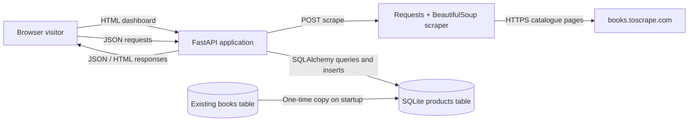
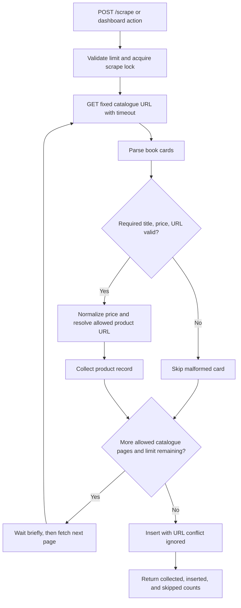
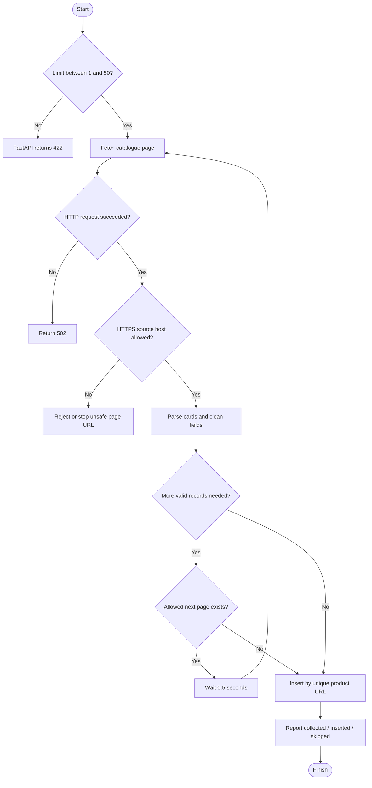
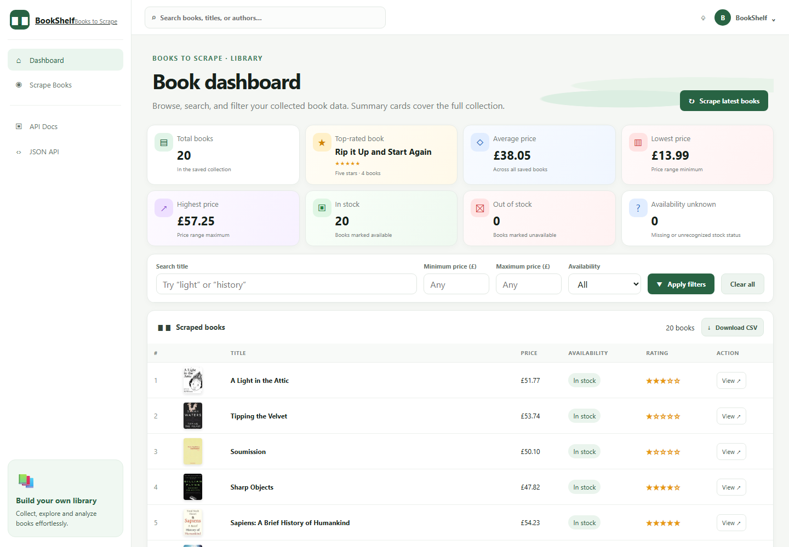
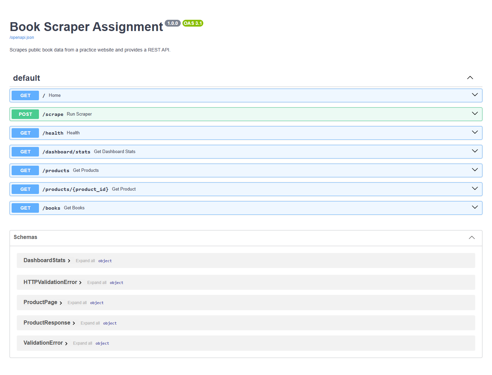

# 1. Title Page

**Project Title:** Automated Product Data Scraping and Search System Using Python, FastAPI, SQLite, GitHub, and Render

**Submitted by:** Sai Patel  
**Roll Number:** To be filled in  
**Class / Branch:** To be filled in  
**College Name:** To be filled in  
**Guide Name:** To be filled in  
**Academic Year:** 2026–27

---

# 2. Certificate / Declaration

## Certificate

This section is reserved for the college's required certificate wording, signatures, and approval. It should be completed and signed by the appropriate college authorities before submission.

## Declaration

I declare that the project details and implementation results in this report should be reviewed and completed by the student before submission. Any institution-specific declaration, signature, and date must be added by the student and college.

**Student signature:** ____________________  
**Date:** ____________________

---

# 3. Acknowledgement

I would like to acknowledge the maintainers of Books to Scrape for providing a public website intended for scraping practice, and the developers of Python, FastAPI, Requests, BeautifulSoup, SQLAlchemy, SQLite, and the other open-source tools used by this project. The project was developed as an educational example; college-specific acknowledgements may be added before submission.

---

# 4. Abstract

The Automated Product Data Scraping and Search System is an educational application that collects publicly accessible book catalogue information from Books to Scrape. The scraper uses Requests to fetch the site's catalogue pages, follows the catalogue's next-page links up to a requested limit, and uses BeautifulSoup to extract each valid book's title, GBP price, rating, stock availability, and product URL. It uses a timeout, brief pacing between page requests, and an HTTPS host allowlist. Cards with invalid or missing essential fields are skipped.

FastAPI exposes a JSON REST API and a browser dashboard. SQLAlchemy stores products in a local SQLite `products` table. Product URLs are unique, and SQLite conflict handling reports how many records were collected, inserted, or skipped. The API supports paginated retrieval, title search, price-range filtering, availability filtering, individual product lookup, and a database health check. Earlier assignment clients remain supported through the unpaginated `/books` route. On startup, existing rows in the previous `books` table are copied into `products` without deleting the original table.

The responsive Bookshelf-style dashboard presents collection-wide total, top-rating, average/minimum/maximum price, and in-stock/out-of-stock/unknown availability summaries. It includes global and form-based search, combined filters, cover thumbnails, rating stars, and ten-row pagination. Automated tests use mocked HTTP responses and an isolated in-memory SQLite database rather than relying on the live source site. The project includes a Render Blueprint configuration and Git instructions. Render deployment was not performed as part of this verification; SQLite data on a free Render filesystem is not guaranteed to persist across restarts or redeployments.

---

# 5. Table of Contents

1. Title Page
2. Certificate / Declaration
3. Acknowledgement
4. Abstract
5. Table of Contents
6. Chapter 1: Introduction
7. Chapter 2: Business Requirement Analysis
8. Chapter 3: System Design
9. Chapter 4: Implementation
10. Chapter 5: Testing and Results
11. Chapter 6: Deployment
12. Chapter 7: Conclusion and Future Scope
13. References
14. Appendix: Code / GitHub Link / API Screenshots

---

# 6. Chapter 1: Introduction

## 1.1 Introduction

Product catalogues contain structured information that can be useful for demonstrations of data collection and search. This project demonstrates a small end-to-end Python workflow: fetch permitted public catalogue pages, extract book fields, persist them locally, and expose them through an API and dashboard.

## 1.2 Business problem statement

Manually reviewing book records across catalogue pages is slow, and raw catalogue HTML is inconvenient for filtering and reuse. The project converts the public practice catalogue into structured records that can be stored, searched, filtered, and displayed consistently.

## 1.3 Objectives

- Scrape only the public Books to Scrape practice website.
- Extract title, price, rating, availability, and product URL.
- Store products in SQLite and avoid duplicates by URL.
- Offer REST endpoints for listing, searching, filtering, and retrieving records.
- Preserve the earlier `/books` API and dashboard while adding the `/products` API.
- Validate the implementation with repeatable tests that do not require live website access.
- Document a GitHub workflow and a Render deployment configuration.

## 1.4 Scope and limitations

The scraper uses the catalogue listing pages and follows their pagination. It is not a general-purpose crawler and accepts no user-supplied scrape URL. The application does not access login-protected content, defeat access controls, or scrape sites other than the stated practice website. Scraping is initiated manually through the API or dashboard; there is no scheduler. The in-process scrape lock and cooldown do not coordinate across multiple application workers. Render's free local filesystem is ephemeral, so the default SQLite file is suitable for a demonstration but is not durable hosting storage.

---

# 7. Chapter 2: Business Requirement Analysis

## 2.1 Existing system

The existing assignment already contained a paginated Books to Scrape scraper, SQLAlchemy and SQLite configuration, a `books` table, `GET /books` search and price filters, a `/scrape` operation, a responsive HTML dashboard, and a small scraper test suite. It did not provide paginated `/products`, product lookup by ID, availability filtering, health status, explicit scrape outcome counts, or comprehensive API/database tests.

## 2.2 Proposed system

The improved system adds a canonical `products` table and migrates existing rows from `books` into it during initialization. It adds `/health`, paginated `/products`, and `/products/{product_id}` while retaining `/books` for existing clients. Scrape responses state actual collected, inserted, and skipped totals. Request pacing, same-process scrape throttling, input validation, and source-host restrictions reduce avoidable load and limit unsafe URL handling.

## 2.3 Functional requirements

- Fetch catalogue pages from `https://books.toscrape.com/`.
- Parse book cards and skip malformed records safely.
- Save product data to SQLite with a unique URL.
- Report actual scrape and insertion counts.
- Search by title and filter by price and availability.
- Paginate product listing and retrieve a product by ID.
- Keep the dashboard and existing `/books` response available.
- Provide a health endpoint and automated offline tests.
- Summarize total books, top ratings, price range and average, and stock state on the dashboard.

## 2.4 Non-functional requirements

- Use timeouts, a short delay between catalogue pages, and safe error responses.
- Use parameterized SQL through SQLAlchemy.
- Keep credentials and local database files out of version control.
- Avoid arbitrary user-provided scraping URLs.
- Keep the interface responsive and provide labels, loading status, and visible errors.
- Keep deployment instructions aligned with the actual `app.main:app` entry point and disclose storage limitations.

## 2.5 Business requirement table

| ID | Requirement | Implementation status |
|---|---|---|
| BR-01 | Scrape public book catalogue fields | Implemented; live requests are not part of automated tests |
| BR-02 | Follow pages and pace requests | Implemented with a 0.5-second inter-page delay |
| BR-03 | Store products and prevent URL duplicates | Implemented in SQLite `products` table |
| BR-04 | Preserve existing book records and routes | Implemented with startup migration and `/books` compatibility |
| BR-05 | Search and filter products | Implemented for title, price bounds, and availability |
| BR-06 | Paginate listings and retrieve one product | Implemented with limit/offset and ID lookup |
| BR-07 | Report service/database health | Implemented at `GET /health` |
| BR-08 | Restrict repeated scrape workload | Implemented with batch limit, in-process lock, and 30-second cooldown |
| BR-09 | Provide responsive dashboard | Implemented; screenshot evidence is included in the appendix |
| BR-10 | Verify behavior offline | Implemented with pytest, mocked scraping, and in-memory SQLite |
| BR-11 | Prepare GitHub and Render documentation | Implemented; deployment itself is not claimed complete |

---

# 8. Chapter 3: System Design

## 3.1 System architecture diagram



## 3.2 Module descriptions

| Module | Responsibility |
|---|---|
| `app/main.py` | FastAPI app, dashboard HTML/JavaScript, health, scrape, product and compatibility routes |
| `app/scraper.py` | Fixed-host Requests client, BeautifulSoup parsing, pagination, URL checks, request timeout and pacing |
| `app/database.py` | SQLAlchemy engine/session, database initialization, legacy table migration, request-scoped DB dependency |
| `app/models.py` | SQLAlchemy `Product` model and the `Book` compatibility alias |
| `app/schemas.py` | Pydantic response schemas for a product and paginated product result |
| `tests/` | Offline scraper, API, and database regression tests |

## 3.3 Data flow diagram



## 3.4 Scraping flowchart



## 3.5 Database schema and table description

The canonical table is `products`. The schema is defined by the SQLAlchemy model and created at application startup.

| Column | Type | Constraints / purpose |
|---|---|---|
| `id` | Integer | Primary key |
| `title` | String | Book title; indexed for lookup |
| `price` | Float | Price converted from GBP text to a number |
| `availability` | String | Text such as `In stock` |
| `rating` | String | Rating class text, such as `Three` |
| `url` | String | Unique product URL used for duplicate prevention |

The previous `books` table is not dropped. When it exists, initialization copies its rows to `products` using `INSERT OR IGNORE`, making migration repeatable while leaving the source table intact.

## 3.6 API endpoint table

| Method and path | Purpose | Important parameters / responses |
|---|---|---|
| `GET /` | Dashboard HTML | `200` HTML |
| `GET /health` | API and DB connectivity | `200` when DB responds; `503` otherwise |
| `GET /dashboard/stats` | Collection-wide book, rating, price, and availability summary | Counts, top-rated titles, and nullable price summaries |
| `POST /scrape` | Scrape fixed public source and insert new records | `limit` 1–50, default 20; `429` when busy/throttled; `502` on source failure |
| `GET /products` | Product listing and search | `search`, `min_price`, `max_price`, `availability`, `limit` 1–100, `offset` |
| `GET /products/export.csv` | Download all filtered products as a CSV attachment | Optional title, price, and availability filters; spreadsheet formula-like text is escaped |
| `GET /products/{product_id}` | Retrieve a single product | `404` when ID does not exist |
| `GET /books` | Backward-compatible book list | Optional `search`, prices, and availability; returns a JSON array |

`/products` returns `{ "total": ..., "limit": ..., "offset": ..., "products": [...] }`. Compatible filters can be combined. Prices are inclusive, title search is case-insensitive, and availability is a case-insensitive substring match.

---

# 9. Chapter 4: Implementation

## 4.1 Technologies and tools

- Python 3 (Render Blueprint configured for Python 3.11.11)
- FastAPI 0.115.0 and Uvicorn 0.30.6
- Requests 2.32.3 and BeautifulSoup 4.12.3
- SQLAlchemy 2.0.35 and SQLite
- Pydantic response models, pytest 8.3.3, and HTTPX 0.27.2 for tests
- Git/GitHub and Render configuration

## 4.2 Actual project folder structure

```text
scrapper/
├── app/
│   ├── __init__.py
│   ├── database.py
│   ├── main.py
│   ├── models.py
│   ├── schemas.py
│   └── scraper.py
├── docs/
│   ├── Book_Scraper_Project_Report.md
│   └── screenshots/
│       ├── api-docs.png
│       └── dashboard.png
├── tests/
│   ├── test_api.py
│   ├── test_database.py
│   └── test_scraper.py
├── .gitignore
├── README.md
├── render.yaml
└── requirements.txt
```

The local `books.db` file is ignored by Git and is not included in the project source listing.

## 4.3 Explanation of the scraper

The scraper starts from a fixed HTTPS URL and follows only next-page links on the allowed `books.toscrape.com` host. Each request uses a 20-second timeout. It parses product cards and skips records without a usable title, price, or URL. Missing rating and availability become `Unknown`; malformed HTML with no matching cards produces an empty result rather than invented records. The pound symbol is stripped before numeric conversion.

Representative implementation:

```python
response = requests.get(
    next_url,
    timeout=REQUEST_TIMEOUT_SECONDS,
    allow_redirects=False,
)
if 300 <= response.status_code < 400:
    raise requests.RequestException("Unexpected redirect from source site")
response.raise_for_status()
soup = BeautifulSoup(response.content, "html.parser")
for item in soup.select("article.product_pod"):
    title_tag = item.select_one("h3 a")
    price_tag = item.select_one(".price_color")
    availability_tag = item.select_one(".availability")
    rating_tag = item.select_one("p.star-rating")
```

The scraper waits 0.5 seconds between catalogue page requests. It does not expose a URL parameter, disables automatic redirects, and rejects product or pagination links outside the expected HTTPS host.

## 4.4 Database implementation

`app/database.py` creates the SQLAlchemy engine and session factory, and `get_db` yields a request-scoped session that is closed after the request. `initialize_database` creates the canonical table and copies legacy book rows without removing the old table. Product insertion uses SQLite's conflict handling on the unique URL constraint:

```python
statement = sqlite_insert(Product).values(records).on_conflict_do_nothing(
    index_elements=[Product.url]
)
result = db.execute(statement)
inserted = result.rowcount or 0
db.commit()
```

If a database write fails, the transaction is rolled back, the internal exception is logged, and the client receives a generic `500` message.

## 4.5 FastAPI endpoints and search/filter logic

`GET /products` composes SQLAlchemy filters for title, lower/upper price, and availability, counts matching rows, and returns a page ordered by ID. `GET /products/export.csv` applies the same filters and downloads every match as a CSV attachment, independent of dashboard pagination. Text cells that could be interpreted as spreadsheet formulas are escaped. `GET /products/{product_id}` returns a schema-validated product or `404`. The existing `/books` endpoint shares the same filter logic but continues to return an unpaginated JSON list. `GET /health` runs a database `SELECT 1`.

The scrape route reports separate counts and retains the old `new_books_saved` response field for compatibility. It limits each scrape to 50 records and uses a non-blocking lock plus a 30-second process-local cooldown.

## 4.6 Error handling

- Invalid query values, reversed price bounds, or an invalid scrape limit return `422`.
- Missing product IDs return `404`.
- A busy or recently used scrape operation returns `429`.
- Source website request failures return `502`.
- Database health failures return `503`; insert failures return `500`.
- Error responses do not include local file paths or internal exception traces.

## 4.7 Security measures

- Scraping is fixed to a trusted HTTPS practice-site host; clients cannot supply arbitrary URLs.
- Automatic HTTP redirects are disabled; product and pagination links are checked against the allowed HTTPS host and standard HTTPS port.
- URL uniqueness prevents duplicate products; database work is expressed through SQLAlchemy parameterized statements.
- Request timeouts, inter-page pacing, a maximum scrape batch, and a cooldown limit repeated work.
- `.gitignore` excludes `.env`, local databases, caches, virtual environments, and build artifacts.
- No credentials are required by the application, and none are included in source or documentation.

These are application-level safeguards, not a claim that every possible deployment configuration is secure. The public scrape endpoint has no authentication and the cooldown is per process; review access control, hosting persistence, worker count, and operational limits before a public production deployment.

---

# 10. Chapter 5: Testing and Results

## 5.1 Test strategy

The suite uses pytest, FastAPI `TestClient`, mocked Requests responses, and an in-memory SQLite database. Automated tests do not contact the live practice website. Scraper tests cover parsing, pagination, pacing, invalid/missing fields, malformed HTML, external links, and request errors. API tests cover HTTP behavior, filters, pagination, duplicate handling, and rate limiting. Database tests cover the legacy migration and the product table.

## 5.2 Test environment

- Test command: `python -m pytest -q`
- Observed interpreter: Python 3.14.2 in the development environment
- Configured deployment interpreter: Python 3.11.11 in `render.yaml`
- Local test output includes a third-party warning that LangSmith's Pydantic V1 compatibility is not supported on Python 3.14; it did not fail this project's tests.

## 5.3 Test cases and results

| Test area | Expected result | Actual result |
|---|---|---|
| Home and health endpoints | Dashboard returns `200`; health confirms DB connection | Passed |
| Scrape reporting and duplicate URLs | Counts reflect collected, inserted, and skipped rows; duplicate URL is not inserted twice | Passed |
| Scrape network failure | Return `502` without leaking the underlying exception | Passed |
| Product search and combined filters | Search, price range, availability, and pagination combine correctly | Passed |
| CSV export | Download all matching products with headers, correct CSV encoding, and formula-like text escaped | Passed |
| Single product lookup | Existing ID returns data; missing ID returns `404` | Passed |
| Invalid API parameters | Return `422` | Passed |
| Scrape cooldown | Recent scrape returns `429` and `Retry-After` | Passed |
| SQLite URL uniqueness and schema migrations | Product URL remains unique; legacy data is copied, old table remains, existing product tables gain the cover column | Passed |
| Scraper parsing and pagination | Fields and product links are extracted; next page is followed with pacing | Passed |
| Invalid/missing fields and malformed HTML | Invalid cards are skipped; optional fields use `Unknown`; malformed page gives no fabricated rows | Passed |
| Unexpected product host and network timeout | External product is skipped; timeout is propagated to API error handling | Passed |
| Full automated suite | All tests pass | Passed (`28 passed`; latest run) |
| Dashboard statistics | Total, price summary, top rating, and stock classifications match seeded records | Passed |
| Browser dashboard check | Dashboard rendered from local DB data with product covers | Passed; 10 rows per page, cover images loaded |
| Browser dashboard KPI and filter check | KPI values match `/dashboard/stats`; availability filtering updates the table without changing full-collection summaries | Passed |
| Browser dashboard pagination and search | Next page changes row numbers and global search returns matching titles | Passed; page two showed rows 11–20, title search returned the matching book |
| Browser CSV download control | Download link includes current dashboard filters | Passed; searching for `light` updated the download URL with `search=light` |
| Responsive dashboard check | Small-screen dashboard remains usable without horizontal page overflow | Passed at 390px viewport; two-column statistic cards |
| Render deployment | Successful deployed service | Not run; no deployment is claimed |
| Live-source scrape in automated tests | Tests work without external network access | Not run by design; HTTP calls are mocked |

## 5.4 Screenshots of the working application

The screenshots below were captured from the locally running application after its collection-wide summary cards and saved-product table loaded. At capture time the database contained 20 books, all marked in stock; the API reported zero out of stock and zero unknown availability for that dataset.





## 5.5 Known issues and limitations

- Automated tests validate behavior using mocks; they do not prove the live site's current HTML remains unchanged.
- Python 3.11.11 is the configured deployment runtime; the available local test interpreter was Python 3.14.2.
- SQLite persistence on Render's free local filesystem is not guaranteed across restarts or redeployments.
- The scrape lock and cooldown coordinate only within one running process.
- Dashboard pagination uses offset-based API requests and shows ten records per page; a search or filter resets pagination to the first page.
- Deployment and GitHub push of these latest changes have not been performed or verified in this report.

---

# 11. Chapter 6: Deployment

## 6.1 GitHub workflow

The existing repository is [bhumireddysivapriya/scapper](https://github.com/bhumireddysivapriya/scapper). Keep its Git history and remote; do not reinitialize or force-push the repository. Review and publish changes from the project directory:

```bash
git status
git add app tests docs README.md requirements.txt .gitignore render.yaml
git commit -m "Improve book scraper API and report"
git push origin main
```

The project currently uses the repository name `scapper`; create a separate repository named `book-scraper-assignment` only if that exact repository name is required and available, then set the correct remote URL.

## 6.2 Render configuration

The checked-in `render.yaml` defines a Python web service using:

- Build command: `pip install -r requirements.txt`
- Start command: `uvicorn app.main:app --host 0.0.0.0 --port $PORT`
- Runtime: Python 3.11.11
- Plan: Free

The module path and ASGI variable correspond to `app/main.py` and its `app = FastAPI(...)` instance. To deploy, connect the GitHub repository to Render or use the Blueprint flow, review the service settings, and initiate the deployment. Deployment was not executed in this task.

## 6.3 Database persistence

By default, the application stores `books.db` in its working directory. `DATABASE_URL` can be set to another SQLAlchemy SQLite URL, for example `sqlite:////var/data/books.db` when a persistent disk is mounted at `/var/data`. Render's free local filesystem may be reset, and free service plans do not imply durable SQLite storage. Configure an available persistent storage option and verify it before relying on records surviving restarts.

---

# 12. Chapter 7: Conclusion and Future Scope

The project now provides an end-to-end educational example for collecting public book catalogue data, storing it in SQLite, and exposing it through a dashboard and REST API. It builds on the original app instead of discarding it: the existing dashboard and `/books` response remain available, and existing records are copied into the new canonical `products` table. The dashboard adds book covers, summary cards, search, filters, and pagination. Mocked tests verify the core scraper, database migration, API filters, pagination, errors, and duplicate handling.

Future work could add scheduled scraping with administrator controls, persistent production storage, deployment smoke tests, authentication for public write operations, and cross-worker rate limiting. Any expansion should continue respecting the practice site's published usage rules and avoid login-protected targets or access-control bypasses.

---

# 13. References

1. Books to Scrape, public scraping-practice catalogue: <https://books.toscrape.com/>
2. FastAPI documentation: <https://fastapi.tiangolo.com/>
3. Requests documentation: <https://requests.readthedocs.io/>
4. Beautiful Soup documentation: <https://www.crummy.com/software/BeautifulSoup/bs4/doc/>
5. SQLAlchemy documentation: <https://docs.sqlalchemy.org/>
6. Python `sqlite3` documentation: <https://docs.python.org/3/library/sqlite3.html>
7. Render FastAPI deployment guide: <https://render.com/docs/deploy-fastapi>
8. Project repository: <https://github.com/bhumireddysivapriya/scapper>

---

# 14. Appendix: Code / GitHub Link / API Screenshots

## A. Key source files

- Scraper: [`app/scraper.py`](../app/scraper.py)
- API and dashboard: [`app/main.py`](../app/main.py)
- Database connection and migration: [`app/database.py`](../app/database.py)
- Product model: [`app/models.py`](../app/models.py)
- API response schemas: [`app/schemas.py`](../app/schemas.py)
- Automated tests: [`tests/`](../tests/)

## B. GitHub link

<https://github.com/bhumireddysivapriya/scapper>

## C. API screenshots

### Dashboard


### Swagger UI


For interactive use after starting the service, open `/` for the dashboard and `/docs` for Swagger UI. API examples are documented in the project README.
